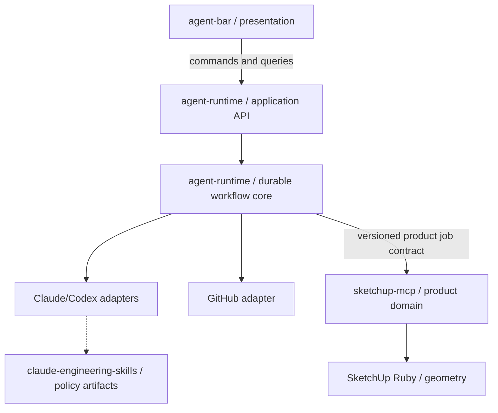

# ADR-001 — Plan2Space domain boundaries and extraction plan

Status: Proposed
Date: 2026-11-19
Target: Plan2Space organization

## Decision
Adopt domain-oriented boundaries inspired by Uber DOMA, without premature network microservices. Keep product domain independent of agent orchestration. Use hexagonal ports/adapters and durable event-driven execution with explicit ownership.

## Repository ownership

| Repository | Owns | Must not own |
|---|---|---|
| `sketchup-mcp` | floorplan ingestion, geometry, scene composition, furnishing, SketchUp Ruby integration, product fidelity, product MCP interface | generic event bus, Claude/Codex CLI supervision, GitHub review workers, desktop agent UI |
| `agent-runtime` (to create) | durable jobs, event envelope, SQLite EventStore/outbox, leasing/fencing, scheduler/supervisor, Claude/Codex provider adapters, GitHub adapters, retry/DLQ, observability events | floorplan/room/SKP semantics, Qt widgets |
| `agent-bar` | PySide6 desktop UI, human approvals, status/observability views, command dispatch via runtime API | durable execution, authoritative state, business logic |
| `claude-engineering-skills` | agent instructions, rules, templates, review policies, reusable skills | running jobs, product code, durable state |

## Dependency direction
- UI -> runtime public API; UI is disposable and must not own job state.
- Runtime -> provider adapters and product plugin contracts, not product implementation.
- SketchUp product -> generic job/command ports only when needed; never import runtime implementation.
- Skills are versioned artifacts consumed by providers, not imported as executable application logic.
- Integration via versioned contracts: JobRequest v1, EventEnvelope v1, JobStatus v1, ArtifactRef v1. Correlation and causation IDs required.
- Runtime persists state before acknowledging work; at-least-once delivery with idempotent consumers, not unproven exactly-once claims.

## Context map

## Extraction classification from sketchup-mcp/tools/orchestration

**Move to agent-runtime, subject to dependency audit and contract tests:**
- `event_store.py`, `store_factory.py`, `event_executor.py`, `executor_delivery.py`
- `process_supervisor.py`, `codex_reviewer.py`, `event_bridge.py`
- generic parts of `execution_guards.py`, `lifecycle.py`, `sandboxed_tests.py`, `appcontainer.py`, `isolation_probe.py`, `allowlist_probe.py`
- Windows event bridge scripts if they are generic

**Move UI to agent-bar after reconciling existing implementation:**
- `tools/orchestration/agent_bar/`; preserve UI-only code, do not duplicate durable state

**Keep product-specific in sketchup-mcp:**
- `furnish_apartment.py`, `scene_composer.py`, `intelligent_pipeline.py`, `fidelity_loop.py`
- `variant_axes.py`, `variant_sweep.py`, `regenerate_consensus.py`, `correction/`
- `promote_artifact.py`, `promote_canonical.py`, `closed_loop_lab.py` pending detailed audit; generic artifact mechanics may later extract behind ports

No file should be moved solely by filename; verify imports, ownership, tests, and behavior first.

## Migration plan (strangler, no flag day)
1. Inventory imports, call sites, tests, CI and PR heads across the three existing repositories. Record dependency graph and ownership decisions.
2. Create `agent-runtime` with pyproject, package boundaries, contract schemas, contract tests, lint/type/test CI, README, ADRs, and versioning. No SketchUp dependency.
3. Copy generic persistence and supervisor components with attribution/history references; port and harden existing tests (concurrent claims, fencing, outbox terminal states, crash recovery). Do not remove original code yet.
4. Introduce a runtime-facing adapter in `sketchup-mcp`; shadow-run then switch behind a feature flag. Compare event and artifact outcomes.
5. Reconcile UI with `agent-bar`; connect it to the runtime API, verify restart and disconnection behavior.
6. Migrate worker/provider/GitHub integrations; prove real E2E with independent CLI sessions and kill/restart recovery.
7. Remove legacy duplicate implementations only after green contract/integration/E2E tests and rollback proof.
8. Update documentation, CI, CODEOWNERS and Project Board. Archive obsolete FP-060 PRs only after mapping reusable work and recording disposition.

## Quality gates
- No product-domain imports in runtime; no runtime implementation imports in product.
- Runtime works without SketchUp or GUI installed; SketchUp core works without Claude/Codex/GitHub/GUI.
- No two authoritative event stores; migration has explicit source of truth and rollback.
- At-least-once plus idempotency; lease fencing and DLQ semantics proven under concurrency.
- No secret exposure in logs; subprocess permissions and sandbox boundaries tested.
- CI required on each repository; independent reviewer and existing human approvals remain intact.
- Never merge pending, failed, or stale checks; avoid churn on the existing FP-060 PR queue.

## Non-goals
- Introducing Kubernetes, Kafka, Cadence, Temporal, service mesh or microservices by default.
- Rewriting working geometry or SketchUp code.
- Claiming autonomous merges without meeting repository policy.

## Open decisions
- API transport (local HTTP, IPC, or CLI) after latency/security requirements.
- Whether to adopt Cadence/Temporal later based on measured operational burden, not fashion.
- Contract versioning and cross-repository release strategy.
