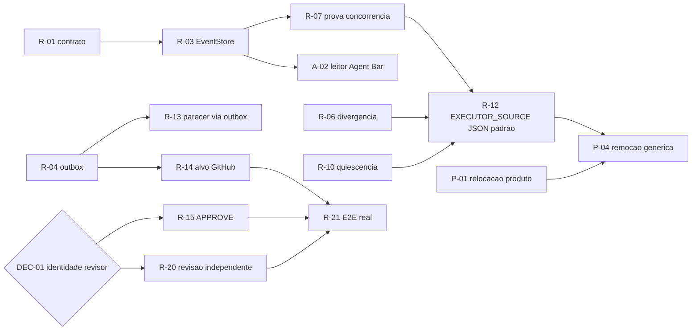

# FP-062 — Plano de execução da migração (SPEC-driven)

> Plan2Space · Status: **EXECUTION_HANDOFF** · versão 1.0.0 · reconciliada em 2026-11-20
> Origem: issue `Plan2Space/sketchup-mcp#676` (handoff de 2026-11-19), épico `#675`, ADR `agent-runtime/docs/adr/0001-extraction-strategy.md`, matriz `agent-runtime/docs/migration/pr-issue-matrix.md`.
> Ferramenta de progresso: skill `spec-progress-keeper` (`Plan2Space/claude-engineering-skills`, PR #26).

## 0. Autoridade e reconciliação com o HEAD

**Autoridade.** Esta SPEC governa somente a reorganização: responsabilidade por repositório, ordem de migração, microtarefas, gates de integração e rollback. Não altera os contratos de FP-060 (§5 eventos, §6 persistência, §7 segurança, §8 fases), as regras de revisão e de board de FP-057, nem as SPECs de geometria (FP-043, FP-044, FP-054, FP-055, FP-056) e `construction_core_microphases.md`. Em caso de conflito, a SPEC existente prevalece e esta é corrigida no mesmo PR.

**Reconciliação (2026-11-20, somente leitura).** Nada foi definido a partir de percentuais; os números abaixo são contagens verificadas.

| Item | Estado verificado | Consequência |
|---|---|---|
| `origin/develop` do sketchup-mcp | `7ea99dae` (merge do PR #667) | Base desta SPEC e de todas as branches novas. |
| Checkout local `develop` do sketchup-mcp | `75f819b3`, **92 commits atrás** de `origin/develop`; upstream aponta para o remote `legacy` (GFCDOTA) | Não usar o checkout local como referência. Atualizar antes de qualquer trabalho. |
| PRs abertos em `Plan2Space/sketchup-mcp` | 0 | Nenhum PR de produto em revisão. |
| Issues abertas em `Plan2Space/sketchup-mcp` | 74 | Inclui os épicos #409 a #415, #675 e #676. |
| Proteção de `develop` (sketchup-mcp) | 1 aprovação obrigatória, `enforce_admins` ativo, 9 checks obrigatórios (§10) | Merge exige aprovação de revisor distinto do autor e checks verdes. |
| Proteção de `main` (claude-engineering-skills) | nenhuma (HTTP 404) | A revisão independente é exigida por esta SPEC, não pelo GitHub. |
| `agent_bar/` em `origin/develop` | **ausente** | FP-060 §0 (2026-11-04) listava `agent_bar/`. O pacote já foi extraído (agent-bar ADR 0012). Correção registrada. |
| `tools/orchestration/executor_delivery.py` em `origin/develop` | **presente** | FP-060 §0 dizia que viria com o PR #598. Correção registrada. |
| `EXECUTOR_SOURCE` em `origin/develop` | sem ocorrências em `*.py` | A integração JSON/SQLite (R-12) ainda não entrou. |
| Worktrees locais do sketchup-mcp | 134 entradas | Nenhuma é removida sem verificar status, log e remote (P-07). |

### 0.1 Evidências de merge e de fechamento

- **agent-runtime**: PRs #27, #28, #29, #30, #31, #32, #43 e #46 mesclados (8). Abertos: #42 e #49.
- **sketchup-mcp** (histórico FP-060): #615, #616, #617, #654, #661 e #667 mesclados. Os demais PRs FP-060 estão fechados sem merge, conforme #676.
- **PR #667** ("E2E descartável D", título com "não mesclar") foi mesclado em 2026-11-16. O histórico de `develop` contém o defeito semeado (`c667f077`) e depois a correção de review (`0bfffe95`). Ver DEC-03.

## 1. Metadata

```yaml
feature: "FP-062 — Plano de execução da migração"
tipo: "SPEC de execução: orquestra as SPECs existentes, não as substitui"
repositorio_proprietario: "Plan2Space/sketchup-mcp"
branch_base: "origin/develop"
repositorios: ["Plan2Space/sketchup-mcp", "Plan2Space/agent-runtime", "Plan2Space/agent-bar", "Plan2Space/claude-engineering-skills"]
depende_de: ["issue #675 (épico)", "issue #676 (handoff)", "FP-057", "FP-060"]
estado: "EXECUTION_HANDOFF"
progresso: "contagens por estado (§7.3); sem percentuais"
```

## 2. Contexto

FP-060 misturou orquestração genérica de agentes com o produto SketchUp. Em 2026-11-19/20 a fila de PRs foi encerrada sem merge para reconstruir por fronteira de domínio (issue #676). Os PRs originais, as branches e as evidências são preservados; nada foi apagado. A migração segue o padrão *strangler*: cada peça é portada com teste e rollback próprios, e o código antigo permanece no ar até a paridade ser provada.

## 3. Objetivos

- **O1.** Cada responsabilidade vive em um único repositório. A dependência aponta para dentro: o runtime não importa produto nem UI; o produto não importa agentes de IA. Medido por grep de imports (AC-07).
- **O2.** Cada PR antigo tem issue substituta e linha na matriz de migração (AC-08).
- **O3.** O runtime tem contrato versionado, pacote instalável e rollback documentado (R-01, R-11).
- **O4.** Uma única fonte autoritativa por fila. A troca de fonte só acontece depois do detector de divergência não acusar divergência (R-06, R-12, P-06).
- **O5.** Provas reais: concorrência e recuperação com processos reais (R-07), e E2E com Claude, Codex, SQLite e GitHub em PR descartável (R-21).
- **O6.** Revisão independente no HEAD final e gates satisfeitos antes de cada merge (G-REV, G-CI, G-MERGE).

## 4. Não objetivos

- Cutover de produção, ou remoção definitiva de código antigo, sem paridade provada e autorização explícita.
- Merge cego de PRs empilhados. Cada PR portado é revisado no diff completo.
- Apagar branches ou PRs fechados.
- Auto-merge, bypass de branch protection, ou aprovação simulada.
- Mudar regras geométricas do SketchUp. O PDF continua como fonte de verdade da posição, conforme as SPECs de geometria.
- Redefinir contratos de FP-060 ou de FP-057.

## 5. Responsabilidades dos repositórios

| Repositório | Possui | Não possui | Contrato de saída | Fonte verificada |
|---|---|---|---|---|
| `agent-runtime` | EventStore durável (SQLite, leases, fencing, DLQ), outbox transacional, workers, adapters de Claude Code e Codex, supervisor Windows, integração GitHub, agendamento, idempotência, recuperação | geometria, SketchUp, móveis, UI | `src/agent_runtime/contracts.py` (envelope de job versionado) | `main` @ `23dc268` |
| `agent-bar` | UI (PySide6, conforme #676), observabilidade somente leitura, comandos pela API do runtime | estado autoritativo da fila | contratos de leitura e de controle (A-02, A-03) | `develop` @ `366b7a6` |
| `sketchup-mcp` | geometria, plantas, cenas, mobiliar, Ruby do SketchUp, adapter MCP do produto | agentes de IA, fila, EventStore (após P-04) | contrato versionado consumido do runtime (P-05) | `develop` @ `7ea99dae` |
| `claude-engineering-skills` | políticas versionadas, skills, templates, instruções de revisão | código de runtime ou de produto | skills e templates | `main` @ `acd4b03` + PR #26 |

## 6. Inventário atual e dependências

### 6.1 sketchup-mcp (`origin/develop`)

Infraestrutura genérica ainda dentro do produto. A classificação é preliminar e cada item é confirmado na microtarefa indicada.

| Caminho | Papel aparente | Destino proposto | Microtarefa |
|---|---|---|---|
| `tools/orchestration/event_store.py` | EventStore | agent-runtime (já portado em R-03) | P-04 |
| `tools/orchestration/event_executor.py` | executor de eventos | agent-runtime | R-12, P-04 |
| `tools/orchestration/executor_delivery.py` | entrega do executor | agent-runtime | R-12 |
| `tools/orchestration/event_bridge.py` | ponte de eventos | agent-runtime | P-04 |
| `tools/orchestration/execution_guards.py` | guardas de execução | agent-runtime | P-04 |
| `tools/validation/execution_state.py` | estado de execução (lock de arquivo) | agent-runtime (durável, R-05, R-08) | P-04 |
| `tools/validation/task_scheduler.py` | agendamento de tarefas | agent-runtime | R-25 |
| `tools/validation/board_sync.py` | sincronização de board | agent-runtime | R-24 |
| `tools/validation/backlog_gate.py`, `tools/validation/issue_integrity_gate.py` | gates de backlog e de issues | a decidir: governança ou runtime | G-05 |
| `core/pipeline_contracts.py`, `tools/orchestration/closed_loop_lab.py`, `tools/orchestration/intelligent_pipeline.py`, `tools/navigation/*` | produto e planta | ficam no produto | verificar acoplamento ao executor em P-04 |

**Relocação em curso.** Branch `feat/fp062-relocate-product` (3 commits sobre `origin/develop`, publicada no remote, **sem PR**):

- `a7f6ff7f`: move 12 módulos de produto para `tools/sketchup/{correction,pipeline}` (41 arquivos no total).
- `ab3d1e7b`: testes de compatibilidade com `python -m` nos aliases relocados.
- `a3499dbd`: registra os caminhos relocados no inventário FP-042.

### 6.2 agent-runtime (`main` @ `23dc268`)

`src/agent_runtime/`: `contracts.py`, `event_store.py`, `outbox_publisher.py`, `durable_file.py`, `state_file.py`, `divergence.py`. Testes em `tests/`, incluindo `test_event_store_processes.py`. CI em `.github/workflows/ci.yml`. `quiescence.py` **não** está em `main`: vem do PR #49, que ainda está aberto.

### 6.3 agent-bar (`develop` @ `366b7a6`)

`agent_bar/`: `app`, `collectors`, `controls`, `geometry`, `models`, `observability`, `operations_view`, `settings`, `window`. Documentação e ADRs 0001 a 0013 (ADR 0012: pacote independente extraído do sketchup-mcp). PR #3 aberto.

### 6.4 claude-engineering-skills (`main` @ `acd4b03`)

Skills existentes mais `spec-progress-keeper` (PR #26, aberto) e o template `templates/spec-progress.md`. Issue #25 também planeja a versão 0.9.0 (ver DEC-04).

### 6.5 Grafo de dependências



## 7. Microtarefas

### 7.1 Tabela de microtarefas

Estados: `BACKLOG`, `READY`, `IN_PROGRESS`, `IN_REVIEW`, `VERIFIED`, `DONE`, `BLOCKED`, `DEFERRED`, `CANCELLED`. IDs são estáveis e não são reutilizados.

**Governança (G)**

| ID | Repo | Microtarefa | Estado | Depende de | Referência / evidência |
|---|---|---|---|---|---|
| G-01 | skills | Skill `spec-progress-keeper` e template | IN_REVIEW | — | PR #26; correção de CI em `f8d8ecf`, re-execução pendente |
| G-02 | sketchup-mcp | Esta SPEC (FP-062) | IN_REVIEW | — | PR aberto nesta entrega |
| G-03 | sketchup-mcp | Decidir identidade do revisor independente | BLOCKED | DEC-01 | issue #524 |
| G-04 | sketchup-mcp | Paridade do board GFCDOTA para Plan2Space (121 itens) | IN_PROGRESS | — | issue #675: cópia feita; paridade não verificada |
| G-05 | sketchup-mcp | Gates que não passam em falso (`pipefail`, exit code) | BACKLOG | — | issue #533 (prova `UNIT_PASS`; estado do PR não verificado) |
| G-06 | sketchup-mcp | CODEOWNERS, automação do board, reconstrução dos gates | BACKLOG | G-03, G-04 | issue #676, item 7 |
| G-07 | sketchup-mcp | Promover `develop` para `main`; segredo `BACKLOG_PROJECT_TOKEN` | BLOCKED | DEC-02 | issues #507, #508 |
| G-08 | sketchup-mcp | Registrar o incidente do PR #667 | BLOCKED | DEC-03 | PR #667 |
| G-09 | skills | Endurecer gates e corrigir drift dos headers de consumidores | BACKLOG | DEC-04 | issue #25 |
| G-10 | skills | Instalar skill `ub-mode` com atribuição MIT | BLOCKED | DEC-07 | issue #24 |

**agent-runtime (R)**

| ID | Repo | Microtarefa | Estado | Depende de | Referência / evidência |
|---|---|---|---|---|---|
| R-01 | agent-runtime | Bootstrap do pacote e contrato de job versionado | DONE | — | PR #27 (`b3d5b04`) |
| R-02 | agent-runtime | Auditoria do grafo de branches empilhadas FP-060 | DONE | — | PR #28 (`dfbe05d`) |
| R-03 | agent-runtime | Portar EventStore core | DONE | R-01 | PR #29 (`bca7e30`). Paridade provada só em R-07 |
| R-04 | agent-runtime | Portar publicador de outbox | DONE | R-03 | PR #30 (`18ccde8`). Issue #25 segue aberta |
| R-05 | agent-runtime | Portar helpers de escrita durável | DONE | R-01 | PR #32 (`5323e4b`) |
| R-06 | agent-runtime | Detector somente leitura de divergência | DONE | R-03 | PR #31 (`eb93c85`). Issue #21 segue aberta |
| R-07 | agent-runtime | Prova de concorrência e recuperação do EventStore com processos reais, leases, fencing e DLQ | READY | R-03 | issue #48 |
| R-08 | agent-runtime | Loader de estado tolerante com quarentena | DONE | R-05 | PR #43 (`079a8fd`). Issue #20 segue aberta |
| R-09 | agent-runtime | Liberar claim bloqueado sem consumir tentativa | DONE | R-03 | PR #46 (`23dc268`), primeira microtarefa do #19 |
| R-10 | agent-runtime | Gate de quiescência com contrato de evidência | IN_PROGRESS | R-06 | PR #49 aberto com CI **vermelho**: `test_lock_offset_must_match_the_owner_byte` falha em 3.11 e 3.12 |
| R-11 | agent-runtime | Pacote instalável, contrato público e install check | IN_REVIEW | R-01 | PR #42 aberto; `CLEAN`, 3 checks verdes; sem revisão |
| R-12 | agent-runtime | `EXECUTOR_SOURCE` com JSON como padrão e SQLite atrás de flag | BACKLOG | R-06, R-07, R-10 | issue #19 (restante); origem em sketchup-mcp #626 |
| R-13 | agent-runtime | Publicar o parecer do revisor pelo outbox, sem POST direto | READY | R-04 | issue #22 |
| R-14 | agent-runtime | Alvo GitHub do publicador com reconciliação de review | READY | R-04 | issue #24 (mesmos arquivos de R-13: sequenciar) |
| R-15 | agent-runtime | Revisor em AppContainer comprovado; liberar APPROVE | BLOCKED | DEC-01, prova de sandbox | issue #23 |
| R-16 | agent-runtime | Validar por CI os testes que o AppContainer não executa | READY | R-11 | issues #2 e #4 |
| R-17 | agent-runtime | Limite de uso do revisor como estado persistente | BACKLOG | — | issue #3 |
| R-18 | agent-runtime | Derrubar árvore de processos sem `taskkill` | BACKLOG | — | issue #5 |
| R-19 | agent-runtime | Supervisor Windows | BACKLOG | R-11 | ADR 0001, ordem 6. **Gap: sem issue** (B-05) |
| R-20 | agent-runtime | Revisão independente verificável e reforço do Quality Guardian | BLOCKED | DEC-01 | issue #36 |
| R-21 | agent-runtime | E2E real com Claude, Codex e GitHub em PR descartável | BLOCKED | R-14, R-15, R-20 | issues #8 e #47 |
| R-22 | agent-runtime | E2E descartável com defeito semeado no ciclo padrão | BACKLOG | R-14 | issue #40. Regra: nunca mesclar |
| R-23 | agent-runtime | Recuperação ponta a ponta no GitHub | BACKLOG | R-12 | issue #38 |
| R-24 | agent-runtime | Reconciliar o board com o limite de taxa da API | BACKLOG | G-04 | issue #39 |
| R-25 | agent-runtime | Scheduler e próxima tarefa do executor; acionamento por review | BACKLOG | R-12 | issues #34, #35, #37 |
| R-26 | agent-runtime | ADR 0001 de estratégia de extração | DONE | — | ADR aceita em 2026-11-20. Issue #1 segue aberta |
| R-27 | agent-runtime | Matriz PR → issue sem perda de evidência | IN_PROGRESS | — | matriz existe em `main`; cobertura completa não verificada |

**agent-bar (A)**

| ID | Repo | Microtarefa | Estado | Depende de | Referência / evidência |
|---|---|---|---|---|---|
| A-01 | agent-bar | Importação standalone, ADRs 0001 a 0013 | DONE | — | `develop` @ `366b7a6` |
| A-02 | agent-bar | Leitor somente leitura do EventStore | IN_PROGRESS | R-03 | issue agent-bar #1; PR #3 aberto |
| A-03 | agent-bar | Contratos de controle pela API do runtime | BACKLOG | A-02, R-01 | sketchup-mcp #628 (P0) |
| A-04 | agent-bar | Barra flutuante de observabilidade | DEFERRED | A-03 | sketchup-mcp #599 (P2). Adiada até A-03 |

**sketchup-mcp (P)**

| ID | Repo | Microtarefa | Estado | Depende de | Referência / evidência |
|---|---|---|---|---|---|
| P-01 | sketchup-mcp | Relocar 12 módulos de produto para `tools/sketchup` e `core` | IN_PROGRESS | — | `feat/fp062-relocate-product`: `a7f6ff7f`, `ab3d1e7b`, `a3499dbd`. Sem PR |
| P-02 | sketchup-mcp | Prova L2 pós-relocação (regressão da planta_74) | IN_PROGRESS | P-01, DEC-05 | `artifacts/review/planta_74/fp062-relocation/`: staged, não commitado, não verificado |
| P-03 | sketchup-mcp | Registrar caminhos relocados no inventário FP-042 | IN_PROGRESS | P-01 | `a3499dbd` |
| P-04 | sketchup-mcp | PR consolidado de remoção da infraestrutura genérica | BLOCKED | P-01 mesclado, R-07, R-12 | `feat/fp062-consolidated-cleanup` existe e não tem commits próprios: não iniciado. Strangler: só após paridade |
| P-05 | sketchup-mcp | Consumir o contrato versionado do runtime, sem import direto | BACKLOG | R-01, R-12 | — |
| P-06 | sketchup-mcp | Gate de quiescência e divergência antes de trocar a fonte | BACKLOG | R-10, R-06 | — |
| P-07 | sketchup-mcp | Limpeza de worktrees e branches FP-060 | DEFERRED | R-27 | 134 entradas. Só com verificação de status, log e remote (regra de worktree com trabalho não mergeado). Branches não são apagadas (#676) |
| P-08 | sketchup-mcp | Verificar os 9 checks obrigatórios no HEAD desta SPEC | BACKLOG | G-02 | não executado nesta reconciliação: UNVERIFIED |

### 7.2 Critérios de aceite e rollback das microtarefas ativas e próximas

| ID | Critérios de aceite (verificáveis) | Prova | Rollback |
|---|---|---|---|
| R-07 | Testes de processo reais com ≥ 2 processos concorrentes e zero claims duplicados; cenário de morte do processo durante o claim com reclaim sem evento perdido; verde em 3.11 e 3.12 | `pytest` com processos reais no CI | revert do PR de prova; nenhum consumidor depende ainda |
| R-10 | `test_lock_offset_must_match_the_owner_byte` verde em 3.11 e 3.12, sem teste desabilitado ou afrouxado; revisão independente no HEAD corrigido | CI do PR #49 | não mesclar enquanto vermelho; revert do PR se mesclado |
| R-11 | `pip install .` em venv limpo, pytest verde em 3.11 e 3.12, contrato público documentado | CI do PR #42 (3/3 verde) | pin da versão anterior; nenhum consumidor ainda |
| R-12 | Com `EXECUTOR_SOURCE=json` (padrão), comportamento idêntico ao atual; com `sqlite`, detector R-06 sem divergência durante o número de ciclos de DEC-06 | testes de flag; relatório do detector | voltar a flag para `json` em um passo, sem migração de dados |
| R-13 | Zero POST direto ao GitHub no caminho do revisor (grep); reenvio do mesmo parecer produz uma única publicação | teste de idempotência do outbox | flag que reabilita o caminho antigo, removida após a prova |
| R-16 | Lista publicada, por teste, de evidência de CI para cada teste que o sandbox não roda | job de CI com relatório | desligar a delegação por configuração |
| A-02 | Leitor sem permissão de escrita (teste: escrita falha); não cria arquivo no banco | teste de permissão no Windows e Linux | remover o leitor; o Agent Bar continua independente |
| P-01 | Movimento só de caminhos e shims; nenhuma mudança de comportamento; testes de compatibilidade verdes | suíte do produto + `python -m` nos aliases | revert do merge |
| P-02 | Regressão da planta_74 sem piora segundo o gate do projeto; artefatos sob a política de DEC-05 | `regression_summary.md` com comparação antes e depois | revert de P-01 |
| P-04 | Zero import de infraestrutura genérica no produto (grep); paridade provada por R-07, R-03 a R-05 e R-12 | grep + suíte | revert do PR consolidado; o código antigo continua no histórico |
| G-01 | CI de sanitização e de integridade verde no HEAD; revisão independente registrada | checks do PR #26 | revert do PR |
| G-04 | 121 de 121 itens com campos, status, aprovações e dependências verificados; divergências listadas | relatório de paridade na issue #675 | o board original permanece como histórico |

### 7.3 Contagens por estado (2026-11-20)

Total de microtarefas: 49.

| Estado | Quantidade | IDs |
|---|---|---|
| DONE | 10 | R-01, R-02, R-03, R-04, R-05, R-06, R-08, R-09, R-26, A-01 |
| IN_REVIEW | 3 | G-01, G-02, R-11 |
| IN_PROGRESS | 7 | G-04, R-10, R-27, A-02, P-01, P-02, P-03 |
| READY | 4 | R-07, R-13, R-14, R-16 |
| BLOCKED | 8 | G-03, G-07, G-08, G-10, R-15, R-20, R-21, P-04 |
| BACKLOG | 15 | G-05, G-06, G-09, R-12, R-17, R-18, R-19, R-22, R-23, R-24, R-25, A-03, P-05, P-06, P-08 |
| DEFERRED | 2 | A-04, P-07 |
| CANCELLED | 0 | — |

Os números são contagens, não progresso ponderado. Nenhuma microtarefa aqui está `VERIFIED` ou `DONE` sem evidência listada na tabela.

## 8. Ordem de execução

1. **Onda 0 (agora):** G-01 e G-02 (revisão), R-11 (revisão e merge), R-10 (corrigir CI vermelho), G-03 (decisão humana).
2. **Onda 1 (desbloqueadas):** R-07, R-13, R-16. R-14 só depois de R-13 (mesmos arquivos). A-02 concluir o PR #3. P-01 abrir PR após separar os artefatos binários (DEC-05).
3. **Onda 2:** R-12 (depende de R-10 mesclado, R-06 e R-07). R-15 depois de DEC-01 e prova de sandbox. P-02 depois de P-01 mesclado.
4. **Onda 3:** R-21 (E2E real), P-05, A-03, R-22, R-23. P-04 só depois da paridade.
5. **Onda 4 (fora do escopo desta SPEC):** cutover de produção e remoção definitiva do código antigo. Exige autorização explícita.

## 9. Critérios de aceite globais

- **AC-01.** Toda microtarefa `DONE` tem: PR mesclado no alvo, CI verde no HEAD mesclado, revisão independente registrada no mesmo SHA e evidência (comando e exit code, ou ID de run).
- **AC-02.** Troca de fonte autoritativa só após o detector de divergência reportar zero divergência durante o número de ciclos de DEC-06 (proposto: ≥ 200 ciclos sintéticos e ≥ 3 execuções reais).
- **AC-03.** Concorrência: zero claims duplicados em ≥ 1000 claims paralelos de processos reais (proposto, DEC-06).
- **AC-04.** Recuperação: morte do executor durante o claim não perde evento e o reclaim ocorre dentro do limite de lease definido no contrato.
- **AC-05.** Rollback por flag: voltar `EXECUTOR_SOURCE` para `json` restaura o comportamento anterior em um passo, testado.
- **AC-06.** E2E real: um PR descartável percorre intake, implementação, revisão e merge automático protegido, ou para em bloqueio explícito. Todos os eventos ficam no EventStore e no GitHub, com data e IDs. O PR descartável nunca é mesclado em `develop`.
- **AC-07.** Independência: `grep` de imports mostra zero dependências de `agent_runtime` e `agent_bar` no produto após P-04, e zero dependências de `sketchup-mcp` no runtime.
- **AC-08.** Rastreabilidade: cada PR fechado listado na matriz tem uma issue substituta com repositório destino e estado.
- **AC-09.** Prova L2 do produto preservada: regressão da planta_74 sem piora segundo o gate do projeto.

## 10. Gates

- **G-CI.** Checks obrigatórios do `develop` do sketchup-mcp: `uv lock is current`, `pytest (py3.11)`, `pytest (py3.12)`, `deterministic fidelity gates`, `mcp server (smoke + stdio handshake)`, `qg: backlog, issues and specs`, `qg: PR policy`, `qg: geometry, program and integration`, `windows process supervisor`. Nos outros repositórios, o workflow próprio do repositório.
- **G-REV.** Revisão independente no HEAD final, de identidade distinta do autor (DEC-01). Não há auto-aprovação nem aprovação simulada.
- **G-L2.** Para mudança de produto, a prova L2 definida pela SPEC de origem (FP-054, FP-055). CI verde não substitui essa prova.
- **G-E2E.** Para R-21 e R-22, o E2E real em PR descartável, registrado com data e IDs. Não conta como merge.
- **G-INT.** Gates não podem passar em falso (issue #533). Um gate que não falha diante de um defeito semeado é reprovado, mesmo com CI verde.
- **G-MERGE.** Merge só quando G-CI, G-REV, e (quando aplicável) G-L2 e G-E2E estão satisfeitos no mesmo SHA. Sem auto-merge sem autorização.

## 11. Estratégia de rollback

- **Por PR:** `revert` do merge commit. Sem force-push, sem reescrita de `develop`.
- **Strangler:** o código antigo do produto permanece até a paridade provada (P-04 depois de R-07, R-03 a R-05, R-12).
- **Flags:** `EXECUTOR_SOURCE=json` como padrão. A fonte SQLite fica atrás de flag desligada por padrão. Auto-merge desligado por padrão (precedente do PR #648).
- **Fonte única:** nunca duas fontes autoritativas. A troca só acontece após o detector sem divergência (AC-02). Rollback = voltar a flag para `json`.
- **Relocação (P-01):** revert do merge. Os shims de compatibilidade mantêm os imports antigos durante a transição.
- **Pacote do runtime (R-11):** pin da versão anterior. Nenhum consumidor depende da API ainda.
- **Dados:** nenhum diretório de dados é removido em bloco. A triagem é por subdiretório, com verificação antes de qualquer remoção.

## 12. Bloqueios e decisões humanas

### 12.1 Decisões humanas pendentes

| ID | Pergunta | Bloqueia | Proposta / opções |
|---|---|---|---|
| DEC-01 | O revisor independente usa conta ou GitHub App distinta do executor? (#524) | R-15, R-20, R-21, qualquer merge que exija revisão verificável | (1) conta ou App separada; (2) manter a identidade atual e aceitar revisão não verificável; (3) outra definida pelo proprietário |
| DEC-02 | Promover `develop` para `main` (#507)? Criar o segredo `BACKLOG_PROJECT_TOKEN` (#508)? | G-07, rotina diária, relatório semanal | decisão do proprietário |
| DEC-03 | PR #667, marcado "não mesclar", foi mesclado. Manter o histórico ou reverter? Criar guarda para que PRs descartáveis não sejam mesclados? | G-08, R-22 | registrar a decisão; a guarda é microtarefa nova se aprovada |
| DEC-04 | Versão 0.9.0 do skills: PR #26 e issue #25 planejam a mesma versão | G-09 | proposta: #26 mantém 0.9.0 e #25 vira 0.10.0. Requer confirmação |
| DEC-05 | Política para artefatos binários (`.skp`, PNG) versionados em `artifacts/review/` | P-02 | manter no git, Git LFS, ou fora do git com referência por hash |
| DEC-06 | Limiares numéricos de AC-02 e AC-03 | AC-02, AC-03 | valores propostos em §9. Requer confirmação |
| DEC-07 | Licença e atribuição da skill `ub-mode` (skills #24) | G-10 | decisão do proprietário |

### 12.2 Bloqueios reais

| ID | Bloqueio | Afeta | Ação necessária |
|---|---|---|---|
| B-01 | PR #49 com CI vermelho (`test_lock_offset_must_match_the_owner_byte`, 3.11 e 3.12) | R-10, R-12 | corrigir no mesmo branch e reexecutar o CI |
| B-02 | Sem identidade distinta, G-REV não pode ser satisfeito com verificação | R-15, R-20, R-21 | depende de DEC-01 |
| B-03 | Worktree `fp062-relocation` com artefatos staged e JSON do FP-042 modificados, não commitados. Dono do trabalho não identificado nesta reconciliação | P-01, P-02 | não tocar. Confirmar o dono antes de commitar ou descartar |
| B-04 | CI do PR #26 (skills): correção em `f8d8ecf`, re-execução pendente | G-01 | acompanhar o CI do PR |
| B-05 | Gap de rastreabilidade: supervisor Windows (R-19) sem issue | R-19 | criar issue no agent-runtime |

## 13. Histórico incremental de progresso

Entradas só são acrescentadas. Correções são novas linhas que referenciam a anterior.

| Data | Versão | Evento | Evidência |
|---|---|---|---|
| 2026-11-20 | 1.0.0 | Reconciliação inicial desta SPEC, somente leitura | `gh` em 3 repositórios; `git worktree list`; `git log` em `origin/develop` e nos repositórios irmãos |
| 2026-11-20 | — | PR da skill `spec-progress-keeper` aberto | `Plan2Space/claude-engineering-skills` PR #26, `7bb2f32` |
| 2026-11-20 | — | CI de sanitização do PR #26 corrigido: gitleaks executado via CLI, sem licença de organização | commit `f8d8ecf` |
| 2026-11-20 | — | ADR 0001 do agent-runtime aceita | `docs/adr/0001-extraction-strategy.md` em `main` |
| 2026-11-20 | — | Achado: PR #49 do agent-runtime com CI vermelho | `test_lock_offset_must_match_the_owner_byte`, 3.11 e 3.12 |
| 2026-11-20 | — | Achado: `EXECUTOR_SOURCE` ausente de `origin/develop` | busca em `*.py` sem ocorrências |
| 2026-11-20 | — | Achado: `agent_bar/` ausente e `executor_delivery.py` presente em `origin/develop`; correções a FP-060 §0 | `git ls-tree origin/develop` |

## 14. Próximas microtarefas

### 14.1 Próximas três desbloqueadas

1. **R-07**: prova de concorrência e recuperação do EventStore com processos reais (issue #48). Vem primeiro porque fecha a dúvida de paridade antes de qualquer remoção. Não depende de nada aberto.
2. **R-13**: publicar o parecer do revisor pelo outbox, sem POST direto (issue #22). Depende de R-04, que está mesclado. Sequenciar R-14 depois, pois toca os mesmos arquivos.
3. **R-16**: validar por CI os testes que o AppContainer não executa (issues #2 e #4). Depende de R-11 apenas para a branch base.

### 14.2 Próximas cinco propostas para execução

1. **R-10**: corrigir o CI vermelho do PR #49. Bloqueia R-12.
2. **R-07**: prova de concorrência e recuperação.
3. **R-13**: parecer via outbox.
4. **A-02**: concluir o leitor somente leitura do Agent Bar (PR #3).
5. **P-01**: triagem e PR da relocação de produto. Os artefatos binários saem deste PR até DEC-05 ser decidida.

## 15. Referências

- Issues: `Plan2Space/sketchup-mcp#675` (épico), `#676` (handoff), `#524` (identidade do revisor), `#533` (gates), `#507`, `#508`.
- agent-runtime: ADR `docs/adr/0001-extraction-strategy.md`, matriz `docs/migration/pr-issue-matrix.md`, PRs #27 a #49.
- agent-bar: ADRs `docs/adr/`, PR #3, issue #1.
- claude-engineering-skills: PR #26, issues #24 e #25.
- SPECs de origem: `docs/specs/FP-057_autonomous_engineering_orchestration.md`, `docs/specs/FP-060_event_driven_agent_orchestration.md`, `docs/specs/construction_core_microphases.md`.
