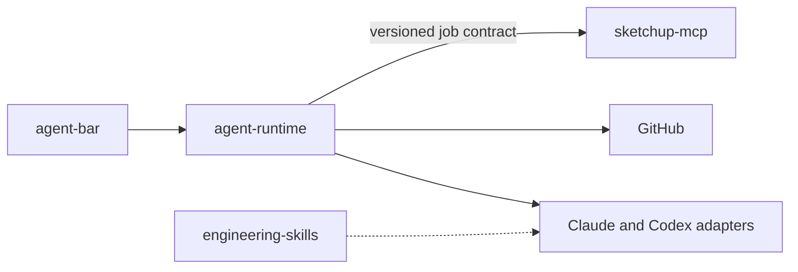

# FP-062 — SPEC: Plan2Space reorganization, board migration, PR reset

**Status:** execution handoff to Claude. **Date:** 2026-11-19. **Migration epic:** https://github.com/Plan2Space/sketchup-mcp/issues/675

## Why all PRs are being closed without merge
FP-060 mixed generic agent orchestration with the SketchUp product. We are resetting the PR queue to rebuild along domain boundaries, inspired by Uber DOMA, while preserving work and evidence. This is **not** rejection of code, completion of tests, or cancellation of features. Each original PR remains the canonical source for full diff, review comments, tests and evidence; branches are not deleted.

## Target owners
- **agent-runtime** (new repo): durable EventStore, outbox, workers, CLI provider adapters, supervisor, GitHub, scheduling, idempotency and recovery.
- **agent-bar**: PySide6 UI, read-only observability and commands via runtime API, not authoritative state.
- **sketchup-mcp**: geometry, floorplans, scenes, furnishing, SketchUp Ruby, product MCP adapter; independent of CLI agents.
- **claude-engineering-skills**: versioned policies, skills, templates, review instructions.

## Claude implementation plan
1. Create Plan2Space organization-level Project and migrate GFCDOTA Project #1 (https://github.com/orgs/GFCDOTA/projects/1). Preserve all items, fields, views, statuses, approvals, dependencies, dates, SPEC and evidence links. Keep original board as historical until parity is verified.
2. Create `Plan2Space/agent-runtime` private repo with package architecture, versioned contracts, CI, tests, ADRs and rollback.
3. For each PR below, review **full diff and review discussions** and create an owner-specific replacement issue. Preserve SHA, issue links, acceptance criteria, tests, review findings, stacked dependency and evidence.
4. Port reusable implementation with strangler migration; never merge stacked PRs blindly or run two authoritative stores.
5. Prove concurrent claims/fencing, outbox terminal-state behavior, crash recovery, Windows supervisor, sandbox, GitHub API and real Claude/Codex E2E. Keep SketchUp working independently.
6. Reconcile duplicate Agent Bar code into standalone UI repo; keep UI optional.
7. Rebuild GitHub governance, CODEOWNERS, board automation and quality gates. Verify all tests/required checks and approvals before merges.
8. Record a PR-to-issue migration matrix, verify no evidence was lost, and report gaps honestly. **Do not delete branches.**

## Full PR provenance catalog
Original links retain the complete PR bodies, patches, review threads and check histories. HEAD commits below pin the precise snapshot. Destination classifications are preliminary, not technical approvals.

### Plan2Space/sketchup-mcp #674: docs(architecture): define Plan2Space domain boundaries and runtime extraction
- URL: https://github.com/Plan2Space/sketchup-mcp/pull/674
- HEAD: `d54e91008f5d090e330897ae317620e66d7473f1` | branch: `docs/architecture-domain-boundaries-20261119` | base: `develop` | draft: false
- Candidate owner: **architecture**
- Original intent: Establish repo ownership and migration strategy before moving FP-060 code. - Uber DOMA-inspired domain boundaries and dependency direction

### Plan2Space/sketchup-mcp #672: feat: land the base side of the sandbox->CI delegation ahead of the reviewer stack (FP-060 MT-03)
- URL: https://github.com/Plan2Space/sketchup-mcp/pull/672
- HEAD: `396ba6a5aac757017255f1548cc263ea95c9dc72` | branch: `feat/fp060-mt03-delegation-base` | base: `develop` | draft: false
- Candidate owner: **agent-runtime**
- Original intent: FP-060 MT-03 — **lado da BASE da delegação sandbox→CI**, separado do #670 para quebrar uma dependência circular. Autorizado pelo proprietário no chat em 2026-11-16 ("Pode abrir"), durante o congelamento de PRs novos. A política de delegação é lida da `develop` (base confiável, nunca do PR). O #670 estava empilhado sobre #630 → #619 → #618. Mas o #618 e o #669 só conse

### Plan2Space/sketchup-mcp #671: fix: reviewer usage limits are persistent account state, not technical failures (FP-060)
- URL: https://github.com/Plan2Space/sketchup-mcp/pull/671
- HEAD: `c1ec6e40dbe37085e169cd469820909afc30abde` | branch: `fix/fp060-rate-limits-pr` | base: `develop` | draft: true
- Candidate owner: **agent-runtime**
- Original intent: FP-060 — **resiliência: o limite de uso da conta do revisor é ESTADO persistente, não falha técnica.** Empilhado sobre #665 (usa `pr_lifecycle` e o `codex_reviewer`); nenhuma outra frente. O Codex respondeu `You've hit your usage limit ... try again at 3:05 PM`. O despachador tratou como falha técnica: consumiu as 5 tentativas do evento em poucos minutos e mandou a re

### Plan2Space/sketchup-mcp #670: feat: delegate git-dependent tests the AppContainer cannot run to a per-test CI evidence chain (FP-060 MT-03)
- URL: https://github.com/Plan2Space/sketchup-mcp/pull/670
- HEAD: `655c2f5d8b8d5ab1cf6a3557bc79e5eae8187600` | branch: `feat/fp060-mt16-sandbox-ci-delegation` | base: `develop` | draft: true
- Candidate owner: **agent-runtime**
- Original intent: FP-060 MT-03 — **validação distribuída (sandbox ↔ CI)** para os testes que comprovadamente não rodam no AppContainer do revisor. Empilhado em #630 (a fiação do sandbox do revisor); nenhuma implementação paralela do coordenador: estende `codex_reviewer.run_coordinator_tests` e `sandboxed_tests.run_pytest`. No AppContainer (sem capacidades, sem rede, sem os arquivos do 

### Plan2Space/sketchup-mcp #669: fix: kill the process tree without taskkill so the review sandbox can run real-process tests
- URL: https://github.com/Plan2Space/sketchup-mcp/pull/669
- HEAD: `5c6884dd7dc6101f714bd9ac4088f02952318860` | branch: `fix/fp060-sandbox-child-processes` | base: `develop` | draft: false
- Candidate owner: **agent-runtime**
- Original intent: Elimina o bloqueio **ambiental** do revisor independente: PRs cujos testes criam processos filhos reais (#643, #652, #640, #642) recebiam `NEEDS_HUMAN` (`tests_passed: false`, 0 achados) porque 6 testes falhavam dentro do AppContainer do sandbox e o veredito não era publicado. Defeito que **impede** o critério de aceite "revisão independente publicada por HEAD" (SPEC 

### Plan2Space/sketchup-mcp #668: docs: auditoria dos criterios de aceite da FP-060 (2026-11-16)
- URL: https://github.com/Plan2Space/sketchup-mcp/pull/668
- HEAD: `3b8f984705687de001a7547a64c888c1b566777b` | branch: `docs/fp060-acceptance-audit` | base: `develop` | draft: false
- Candidate owner: **evidence**
- Original intent: Auditoria dos critérios de aceite da FP-060 (SPEC §8, §9, §12 e §12.1) com o estado honesto de cada item (FEITO / EM PR / PARCIAL / ABERTO / BLOQUEADO) e a evidência. Não declara a FP-060 concluída: lista o que falta (proteção da `develop`, merge automático do ciclo completo, tarefa agendada + reboot/soak, drenagem dos PRs). SKP-proof: N/A — documentação de orquestraç

### Plan2Space/sketchup-mcp #665: feat: ciclo padrao de PR e acionamento automatico do Codex por solicitacao de revisao (FP-060 MT-17)
- URL: https://github.com/Plan2Space/sketchup-mcp/pull/665
- HEAD: `b058e9c3cd58403044e9870f60607c0e257b3013` | branch: `feat/fp060-pr-lifecycle` | base: `develop` | draft: true
- Candidate owner: **agent-runtime**
- Original intent: MT-17 (#664), critério de aceite obrigatório da FP-060 (SPEC §12.1): ciclo padrão dos PRs técnicos e acionamento **automático** do Codex a partir da solicitação de revisão. **Empilhado sobre #648** (usa `auto_merge`: gather, decisão, identidade, proteção). Reutiliza o que já existe — EventStore (eventos, lease, fencing, DLQ), `codex_reviewer` (sessão real do Codex, Ou

### Plan2Space/sketchup-mcp #663: feat: Agent Bar le o EventStore real, somente leitura (FP-060 MT-09)
- URL: https://github.com/Plan2Space/sketchup-mcp/pull/663
- HEAD: `8b15414ba015ada40423a56cf2c1b555f7ce42eb` | branch: `feat/fp060-mt09-agent-bar-store` | base: `develop` | draft: false
- Candidate owner: **agent-bar**
- Original intent: MT-09 (#628): o **Agent Bar** passa a mostrar o **EventStore (SQLite) real**, somente leitura. Parte do `develop`. - `collect_store` (`agent_bar/collectors.py`): lê `event_store.db` pela URI `mode=ro` (caminho codificado) e informa fila por status, **backoff** de retry, **leases vivos** (dono e segundos restantes), **lease vencido** (RUNNING com lease expirado = worke

### Plan2Space/sketchup-mcp #660: docs: evidencia versionada do E2E real da FP-060 (MT-06)
- URL: https://github.com/Plan2Space/sketchup-mcp/pull/660
- HEAD: `3f7710d9cd51ea9ede983737c136fc0b96b03c57` | branch: `docs/fp060-mt06-e2e-evidence` | base: `develop` | draft: false
- Candidate owner: **evidence**
- Original intent: Versiona a **evidência datada** do E2E real da MT-06 (#625): três fluxos com Claude, Codex e GitHub reais em PRs/Issues descartáveis (fechados sem merge): correção (#651), implementação pelo worker (#655) e **corrida contínua** sem disparo manual depois da label (#659). Contém `README.md` (o que é, linha do tempo, defeitos achados e corrigidos, **o que não é**), `data

### Plan2Space/sketchup-mcp #657: feat: intake e revisao publicada no laco do executor, desligados por padrao (FP-060 MT-16)
- URL: https://github.com/Plan2Space/sketchup-mcp/pull/657
- HEAD: `f7196f2d056a455ef781c9a48871bd295c137579` | branch: `feat/fp060-mt16-loop-steps` | base: `develop` | draft: true
- Candidate owner: **agent-runtime**
- Original intent: MT-16 (#656): liga ao **laço do executor** os dois passos que faltavam para uma tarefa autorizada percorrer o ciclo sozinha, ambos **desligados por padrão**. Empilhado sobre o #649 (que já inclui #636/#641/#642/#646/#648). No E2E real, cada etapa foi um comando manual: o intake (`intake publish`) e o revisor (`codex_reviewer review --publish`). Além disso `lifecycle.r

### Plan2Space/sketchup-mcp #652: fix: executor confirma o HEAD publicado em vez de confiar em leitura velha (FP-060 MT-06)
- URL: https://github.com/Plan2Space/sketchup-mcp/pull/652
- HEAD: `a6753bd243fb24f0c55b9c7df3dc6a0b6d1d2805` | branch: `fix/fp060-executor-push-confirmation` | base: `develop` | draft: false
- Candidate owner: **agent-runtime**
- Original intent: Corrige um defeito achado no **E2E real da MT-06** (#625): o executor **publicou** a correção do Claude (o HEAD do PR descartável #651 passou para o commit do executor), mas registrou a tentativa como `FAILED: terminou sem commit novo no PR`. Parte do `develop`. Logo depois do `git push`, a leitura REST do PR ainda devolvia o HEAD **antigo**; o executor tratou isso co

### Plan2Space/sketchup-mcp #649: feat: reconciliacao e merge automatico protegido no ciclo do executor (FP-060)
- URL: https://github.com/Plan2Space/sketchup-mcp/pull/649
- HEAD: `f27be759473e57040af9a960bf41dd8f1898fbdd` | branch: `feat/fp060-wire-reconcile-automerge` | base: `develop` | draft: false
- Candidate owner: **agent-runtime**
- Original intent: Integra ao **ciclo do executor** a reconciliação do SQLite (MT-12, #638) e o merge automático protegido (MT-15, #647). **Empilhado** sobre #646 (worker, que inclui #636 e #641), #642 e #648; o diff próprio é só `run_cycle` + `tests/test_cycle_wiring.py` (o resto é o merge dos três ramos). - `store_reconcile`: no máximo a cada 5 min. **Aplica** (`supersede` de pedido o

### Plan2Space/sketchup-mcp #648: feat: merge automatico protegido sem labels manuais, desligado por padrao (FP-060 MT-15)
- URL: https://github.com/Plan2Space/sketchup-mcp/pull/648
- HEAD: `7e4ff55f5bbebb76c2294ebff70d55a7d44495a7` | branch: `feat/fp060-mt15-auto-merge` | base: `develop` | draft: false
- Candidate owner: **agent-runtime**
- Original intent: MT-15 (#647): **mecanismo** de merge automático protegido. **Desligado por padrão** (`AUTOMERGE_ENABLED=1` + `--apply`; o interruptor `AUTOMERGE_DISABLED` vence). Parte do `develop`. **Nenhuma label manual de autorização** para merge técnico ordinário; decisões humanas das SPECs preservadas.

### Plan2Space/sketchup-mcp #646: feat: worker de implementacao para IMPLEMENT_REQUESTED (FP-060 MT-11 estagio 2)
- URL: https://github.com/Plan2Space/sketchup-mcp/pull/646
- HEAD: `6da449f181c90bd302c85e5a9085ede306b65ef5` | branch: `feat/fp060-mt11-s2-implement-worker` | base: `develop` | draft: false
- Candidate owner: **agent-runtime**
- Original intent: MT-11 (#637), **estágio 2**: o worker de implementação. **Empilhado** sobre o #636 (S2, fonte SQLite) e o #641 (intake); o diff próprio deste PR são `implement_worker.py`, o despacho no executor, `sqlite_source` aceitar o evento e o argumento opcional `message` em `deliver`. 1. **Preflight no GitHub a cada tentativa:** identidade do executor; Issue aberta e não é PR; 

### Plan2Space/sketchup-mcp #645: feat: checks da entrega do executor rodam no AppContainer (FP-060 MT-14)
- URL: https://github.com/Plan2Space/sketchup-mcp/pull/645
- HEAD: `d5e7d47d51a6af1e047bc64d1dd166fccc051814` | branch: `feat/fp060-mt14-executor-sandboxed-checks` | base: `develop` | draft: true
- Candidate owner: **agent-runtime**
- Original intent: MT-14 (#644): `executor_delivery.run_checks` passa a rodar os testes **dentro do AppContainer**. Empilhado sobre o #630 (que traz `sandboxed_tests` com `dists`/`skip`, do #617). `run_checks` devolvia `False` incondicionalmente ("requer sandbox de SO real"), então `deliver()` **nunca publicava** uma correção do Claude em produção: o fluxo "Codex pede mudanças → Claude 

### Plan2Space/sketchup-mcp #643: fix: trava de arquivo do estado de execucao nao fica presa no Windows
- URL: https://github.com/Plan2Space/sketchup-mcp/pull/643
- HEAD: `a7c3a9d762b25e6badb5be933abb1896dff9039a` | branch: `fix/fp060-lock-windows-sharing-violation` | base: `develop` | draft: false
- Candidate owner: **agent-runtime**
- Original intent: Corrige a causa do teste instável `test_two_executors_racing_for_the_same_task_only_one_wins` e, com ela, um defeito real da operação autônoma: a **trava curta do estado de execução** (`execution_state.locked`), usada pelo executor, pelo bridge e pelo agendador, deixava de excluir processos no Windows (`unlink`/abertura com `PermissionError`, WinError 32). - `locked()

### Plan2Space/sketchup-mcp #642: feat: reconciliar eventos do SQLite com fatos do GitHub (FP-060 MT-12)
- URL: https://github.com/Plan2Space/sketchup-mcp/pull/642
- HEAD: `c6e26713d3888b9d274ccdbb034d3063d5e14e89` | branch: `feat/fp060-mt12-store-reconcile` | base: `develop` | draft: false
- Candidate owner: **agent-runtime**
- Original intent: MT-12 (#638): evento pendente do SQLite reconciliado com os **fatos do GitHub**. Parte do `develop`, independente dos outros PRs. Cada fonte já era reconciliada isoladamente (`lifecycle`: PR/CI/review; `backlog_reconcile`: Issue/PR/Project; `shadow_divergence`: JSON×SQLite). Faltava ligar o **SQLite** aos fatos do GitHub: um `CORRECTION_REQUESTED` que ficou PENDING en

### Plan2Space/sketchup-mcp #641: feat: intake de Issue autorizada para IMPLEMENT_REQUESTED (FP-060 MT-11 estagio 1)
- URL: https://github.com/Plan2Space/sketchup-mcp/pull/641
- HEAD: `2742ab1d0a08e3c09a2cffc66477c4d0d1270f6e` | branch: `feat/fp060-mt11-intake-planner` | base: `develop` | draft: false
- Candidate owner: **agent-runtime**
- Original intent: MT-11 (#637), **estágio 1**: uma Issue pronta e **autorizada por um humano** vira um evento `IMPLEMENT_REQUESTED` no EventStore. Parte do `develop`. Hoje o executor só age sobre `CHANGES_REQUESTED` de um PR que já existe. Nenhum caminho de produção transforma uma tarefa cadastrada no board em implementação; é a lacuna entre "cadastrei a tarefa" e o resto do ciclo.

### Plan2Space/sketchup-mcp #640: fix: laco do executor sobrevive a erros de ciclo (FP-060 MT-13)
- URL: https://github.com/Plan2Space/sketchup-mcp/pull/640
- HEAD: `af8aee01f680c19c537f41b57f27091be256e8bb` | branch: `feat/fp060-mt13-executor-loop-resilience` | base: `develop` | draft: false
- Candidate owner: **agent-runtime**
- Original intent: MT-13 (#639): um erro num ciclo do executor **não derruba mais o processo**. Parte do `develop`, independente dos outros PRs. `event_executor.main` não protegia `run_cycle`: qualquer exceção (rede, GitHub, arquivo de estado ilegível) encerrava o processo, e a tarefa agendada só o reinicia 3 vezes. Em 2026-11-15 o executor já estava parado por uma exceção não tratada (

### Plan2Space/sketchup-mcp #636: feat: executor reivindica do EventStore atras de EXECUTOR_SOURCE (FP-060 MT-07 S2)
- URL: https://github.com/Plan2Space/sketchup-mcp/pull/636
- HEAD: `e90ba2d99804376bb2ef1321f2417900edd33522` | branch: `feat/fp060-mt07-s2-sqlite-claim` | base: `develop` | draft: false
- Candidate owner: **agent-runtime**
- Original intent: MT-07 / **S2** (#626): o executor passa a poder reivindicar do **EventStore (SQLite)** em vez da fila JSON, atrás de `EXECUTOR_SOURCE`. O padrão continua `json`; **nada é ligado em produção** por este PR. Empilhado sobre o #634 (S1, detector de divergência). - **`tools/orchestration/sqlite_source.py`** (novo) + três pontos de despacho em `event_executor.py` (`claim_ne

### Plan2Space/sketchup-mcp #635: fix: write the bridge state durably and recover from a corrupt state file (#633)
- URL: https://github.com/Plan2Space/sketchup-mcp/pull/635
- HEAD: `2aab2ffd0062e917b89b61bfd001b628d7881a4d` | branch: `fix/fp060-bridge-state-durability` | base: `develop` | draft: false
- Candidate owner: **agent-runtime**
- Original intent: Corrige o #633: o estado do bridge (`event_bridge.json`) passa a ser gravado de forma **durável** e a ser lido de forma **tolerante a corrupção**, sem nunca perder evidência. Parte do `develop`, não está empilhado em nenhum outro PR. `runs/governance/event_bridge.json` tinha **20.888 bytes, todos zero** (última escrita em 13/11 10:02). `event_bridge.load()` levantava 

### Plan2Space/sketchup-mcp #634: feat: add a read-only detector of divergence between the executor queue and its mirror (FP-060 MT-07 S1)
- URL: https://github.com/Plan2Space/sketchup-mcp/pull/634
- HEAD: `d0523a371f881ba942f1c970f0f9af3660aac376` | branch: `feat/fp060-mt07-s1-divergence` | base: `develop` | draft: false
- Candidate owner: **agent-runtime**
- Original intent: FP-060 **MT-07 / S1** (#626, #606) — detector de divergência entre a fila JSON do executor e o espelho no `EventStore`. **Somente leitura**: não escreve na fila nem no banco. É o critério de entrada do cutover do executor para o SQLite: enquanto os dois lados não concordam, trocar o caminho de execução é trocar uma verdade por outra. Este PR **não está empilhado** nos

### Plan2Space/sketchup-mcp #632: feat: publish the codex_reviewer's verdict through the transactional outbox (FP-060 MT-05)
- URL: https://github.com/Plan2Space/sketchup-mcp/pull/632
- HEAD: `63c35a1a9d857dcc98e93a368b8caf53f09816d1` | branch: `feat/fp060-mt05-review-outbox` | base: `develop` | draft: true
- Candidate owner: **agent-runtime**
- Original intent: FP-060 **MT-05** (#624, #606) — o parecer do `codex_reviewer` passa a ser publicado pelo **outbox transacional**, e o POST direto sai do caminho de produção. Antes, `review_pr` chamava um `gh api -X POST` que não reconciliava nem sobrevivia a uma morte entre o POST e a confirmação. **Empilhado em #617, #618, #619 e #630.** Enquanto não entrarem em `develop`, o diff mo

### Plan2Space/sketchup-mcp #630: feat: run the codex_reviewer's coordinator tests in a proven AppContainer (FP-060 MT-04)
- URL: https://github.com/Plan2Space/sketchup-mcp/pull/630
- HEAD: `08cef4c6db546b0f25b22359dfb55fe028f3db03` | branch: `feat/fp060-mt04-codex-reviewer-sandbox` | base: `develop` | draft: false
- Candidate owner: **agent-runtime**
- Original intent: FP-060 **MT-04** (#623, #606) — os testes do coordenador do `codex_reviewer` passam a rodar dentro de um AppContainer **provado**, e um `APPROVE` do Codex passa a poder ser publicado. Antes, `run_coordinator_tests` era fail-closed e nunca executava nada: todo parecer chegava com `tests_skipped_no_sandbox`. **Empilhado em #617, #618 e #619** (o código do sandbox, do ou

### Plan2Space/sketchup-mcp #619: feat: add the GitHub review target for the outbox publisher (FP-060 M2)
- URL: https://github.com/Plan2Space/sketchup-mcp/pull/619
- HEAD: `6e0e395e0b0c64df304b46ad25294b9bd9cdf40f` | branch: `feat/fp060-m2-github-review-target` | base: `develop` | draft: false
- Candidate owner: **agent-runtime**
- Original intent: FP-060 M2 — destino GitHub para o publicador do outbox (#618): publica o parecer da revisão independente num PR, reconciliando pela chave antes de cada envio. **Os testes são deterministas (GitHub em memória). A prova contra o GitHub real está na evidência versionada abaixo.** **Empilhado no #618 (que está empilhado no #617):** enquanto eles não entrarem em `develop`,

### Plan2Space/sketchup-mcp #618: feat: publish outbox entries with reconciliation before every send (FP-060 M2)
- URL: https://github.com/Plan2Space/sketchup-mcp/pull/618
- HEAD: `58f9b5cb2210eb91000366c6e3ada3a1f4ac5123` | branch: `feat/fp060-m2-outbox-publisher` | base: `develop` | draft: false
- Candidate owner: **agent-runtime**
- Original intent: FP-060 M2 — publicador do outbox com **reconciliação antes de cada envio**, provado primeiro no laboratório closed-loop com um alvo local. Fecha, no nível do contrato, a exigência do M2 "publicação externa via outbox idempotente com reconciliação": o `EventStore` já enfileirava o efeito na transação que conclui o evento, mas nenhum código consumia essa fila. **Empilha

### Plan2Space/sketchup-mcp #614: chore(FP-060): install ub-mode review skill with governance guardrails
- URL: https://github.com/Plan2Space/sketchup-mcp/pull/614
- HEAD: `62fbd28543cb7b37dd92127b02f475bef0b4c1ef` | branch: `chore/fp060-install-ub-mode-skill` | base: `develop` | draft: false
- Candidate owner: **skills**
- Original intent: Instalar a skill de engenharia/revisão `ub-mode` do Uncle Bob no projeto Claude Code em `.claude/skills/ub-mode/SKILL.md`, com licença MIT e atribuição preservadas. - FP-060/FP-060-A01, constituição, CI/Quality Guardian e revisão independente prevalecem.

### Plan2Space/sketchup-mcp #605: poc: isolated SQLite event bus with subprocess workers and recovery
- URL: https://github.com/Plan2Space/sketchup-mcp/pull/605
- HEAD: `8712949b4adc292a09509422e56d8ea0b5a19db6` | branch: `poc/isolated-sqlite-event-bus` | base: `develop` | draft: false
- Candidate owner: **evidence**
- Original intent: Preserva em `docs/spikes/sqlite_event_bus_poc/` o laboratório SQLite, os adapters Claude Code/Codex CLI, testes e evidências registradas em `evidence/2026-11-05_real_cli/REPORT.md`. Não altera o runtime de produção, listener, scheduler ou tarefas Windows. O relatório registra dois cenários com CLIs reais, correção após revisão e quatro verificações de resiliência. A s

### Plan2Space/claude-engineering-skills #23: Full-repo audit: consumer-wiring gate + gate hardening + template/theming + fixture fixes (v0.9.0)
- URL: https://github.com/Plan2Space/claude-engineering-skills/pull/23
- HEAD: `abbda74003e7c405d14718ec154c2d7267c33af6` | branch: `feat/consumer-wiring-integrity` | base: `main` | draft: false
- Candidate owner: **skills**
- Original intent: A full-repository validation (structural checks + a four-agent adversarial content review; every script bypass was **reproduced with a fooling input before being fixed**), followed by the fixes. 39 files, all four gates green (`repo-integrity-check` + `sanitization-check`, check and `--selftest` modes). **12 lens consumer headers had drifted**: skills added in v0.2.0–

## Closing policy
Close all 29 PRs without merge, each with explicit comment linking this SPEC and epic #675. Preserve branch and HEAD. PR #674 and skills #23 are also closed as part of the user's full reset, not due to technical rejection. The board migration is pending until independently verified.